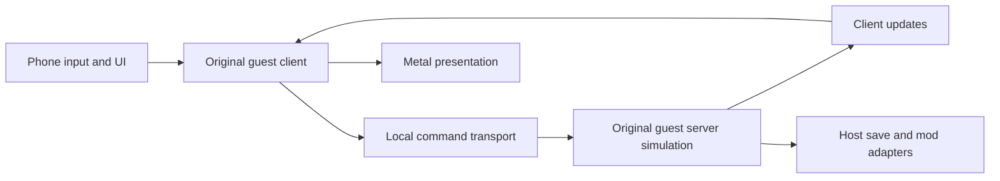
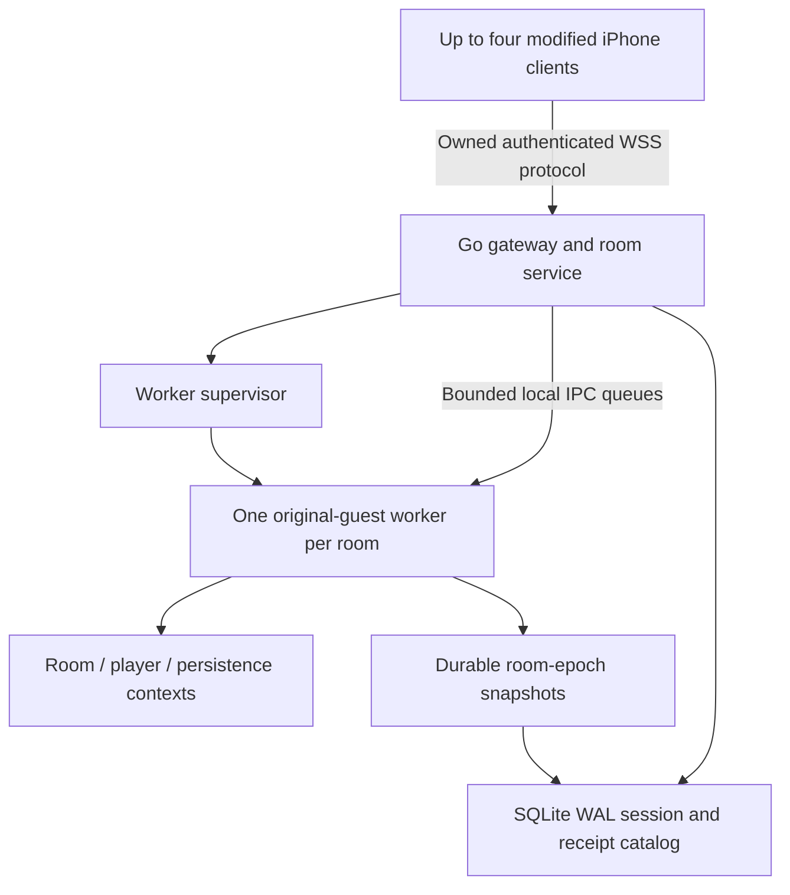

# Private Four-Player D2R Server

**Status:** Independently reviewed conditional proposal; implementation depends on the unpassed feasibility gates below  
**Package:** d2r-server  
**Date:** 2026-10-20  
**Source baseline:** upstream v1.0.18, `120fe55c02a5633476998a44f8c3c3c809fa48b0`

## Version History

| Version | Date | Summary |
|---|---|---|
| 0.1 | 2026-10-20 | Evidence-based proposal for modified iPhone clients and a private Linux deployment. |
| 0.2 | 2026-10-20 | Incorporated independent review: idempotent admission, fenced cancellation and safe lease release. |
| 0.3 | 2026-10-20 | Incorporated Copilot review and completed independent re-review: no unresolved major specification findings; all execution gates remain unpassed. |

## Table of Contents

1. [Problem Statement](#1-problem-statement)
2. [Current Architecture](#2-current-architecture)
3. [Requirements](#3-requirements)
4. [Options Evaluation](#4-options-evaluation)
5. [Recommended Approach](#5-recommended-approach)
6. [Migration and Verification Gates](#6-migration-and-verification-gates)
7. [Test Strategy](#7-test-strategy)
8. [Observability and Telemetry](#75-observability-and-telemetry)
9. [Risk Assessment](#8-risk-assessment)
10. [Decision Records](#9-decision-records)

## 1. Problem Statement

The installed game runs its client and authoritative game simulation locally. It has no demonstrated private multiplayer service for four phones. We need shared combat, monsters, drops and quests while retaining phone-owned characters and deploying the authority on Linux/Docker.

The open-source repository supplies a host, platform adaptation and game modifications; the original simulation remains in the supplied game binary. Existing command replay is a diagnostic facility within an initialized local session. Its single remembered game/client identity and direct dispatcher injection are not a multiplayer implementation (`dm/host/diag.c:1151–1177,1378–1394`).

The companion [protocol and runtime evidence report](2026-10-20-protocol-research.md) records source permalinks, actual REA evidence, external precedents and unresolved questions. This proposal distinguishes **verified internal seams** from **proposed interfaces** and **unpassed feasibility gates**. It does not specify a recovered official network protocol.

## 2. Current Architecture



The local simulation advances at 25 ticks/second (`hle_hid.c:161`; scheduler interpretation in `diag.c:1433–1445`). Rendering and network cadence are separate concerns.

REA/Ghidra now independently confirms two bodies in the shipped artifact:

- Sender `main+0x2ceab0` submits a byte range through the inline object at `main+0x2d9f438`, virtual method `+0x30`. Its `<0x200` length guard belongs to that entry only.
- Receiver `main+0x632510` consumes a leading connection number, resolves connection → game → player, and calls the gameplay dispatcher `0x6e5b40`. It advances the pointer by four bytes while forwarding the unchanged length argument. The caller's length convention remains unresolved.

Source also implements a server-to-client send through the inline object at `main+0x2d7f3d8`, virtual method `+0x28`, with a recipient connection number and begin/end range (`dm_elysium.c:325–339`). Concrete transport implementations, buffer lifetime, complete S2C framing, admission and remote-client startup still need proof. Diagnostic JSON, state hashes and internal pointers cannot serve as network packets.

Linux reuse requires a new host profile. Current dependencies include Darwin thread-local storage (`loader.c:42–49`), below-SP patch scratch space (`dm/tools/patch_nso.py:391–420`), Mach memory/signal handling, Apple frameworks and APFS save transactions (`hle_fs.c:22,36–41,429–475`). Windowless execution does not establish a graphics-free engine. Rendering/presentation can also drive deterministic time.

Affected components are guest loading/rewriting, platform HLE, scheduler, transport ports, account/filesystem adapters, phone entry/exit flows, cloud synchronization and mods. Current account, save, pages, vault and rift singletons need explicit ownership; one process per room isolates rooms but does not separate four players inside one room.

## 3. Requirements

| ID | Required behavior |
|---|---|
| R1 | A private room admits at most four independently identified players. A fifth admission fails without disturbing the room. |
| R2 | Modified iPhone clients render and submit actions; one server simulation owns shared gameplay results. Phones do not run competing authoritative worlds. |
| R3 | Every admission imports a fresh immutable snapshot of the selected phone-local character and the associated persistence data. No permanent server character roster is required. |
| R4 | Committed character results return safely to the originating phone, including relevant mod sidecars and shared-stash changes. Interrupted return must remain recoverable. |
| R5 | Linux/Docker deployment supports a documented, measured worker platform. CPU architecture is undecided. |
| R6 | Joining peers must match the supported guest build, game tables, mod rules and protocol profile before admission. |
| R7 | Disconnect, reconnect, server crash, phone suspension and concurrent cloud operations have explicit ownership and recovery behavior. |
| R8 | One room's crash or resource exhaustion must not corrupt another room or a phone's last committed local save. |

Nice-to-have: invitation links and modest administrative room inspection. Unmodified official clients, Battle.net emulation, public matchmaking, cross-version shims and global anti-duplication across independently edited offline save forks are outside scope. The latter cannot be guaranteed while the phone retains offline ownership.

## 4. Options Evaluation

| Strategy | Rule fidelity | Linux/CPU implications | Evidence and cost |
|---|---|---|---|
| A. Reuse guest simulation; build a new transport and Linux host | Preserves original rules if separation succeeds | Original guest is ARM64; native ARM64 host or measured instruction translation needed | Strong internal seams; headless lifecycle, admission and multi-player mods unproved. Recommended conditional route. |
| B. Write an independent server simulation | Every rule, quest, item and mod must be reproduced | Native implementation can target x86_64 and ARM64 | Removes original-runtime coupling but entails much greater behavioral reconstruction. A separate project if A fails its decisive gates. |
| C. Adapt an existing D2R or classic server ecosystem | Varies by engine and build | Modern D2RLoader precedent is Windows x64; classic D2GS targets older Diablo II | Useful research reference; no verified Linux/Switch-ARM interoperability or drop-in replacement. |

[D2RLoader](https://d2rloader.net/tcp-ip.html) documents private multiplayer using local offline characters. Its SDK exposes dedicated-host preparation, but this is a precedent, not proof that its core can be reused here. Classic D2GS and incomplete open engines do not establish compatibility with this guest; evidence and licenses are compared in the companion report.

Storage alternatives are SQLite WAL plus durable filesystem snapshots, PostgreSQL plus object storage, and an in-memory room catalog. Select SQLite/filesystem for a single-host private deployment: it supports durable session receipts without introducing distributed ownership. In-memory-only storage cannot satisfy R4/R7; distributed storage adds no justified requirement here.

## 5. Recommended Approach

### 5.1 Components and authority



Use C/assembly for the guest host and ABI-specific bridge, and Go for the gateway, room service and supervisor. Worker interfaces must be based on verified guest ownership and lifecycle contracts. The control plane can run on x86_64 even if the worker ultimately requires ARM64. Docker packages an established runtime; it does not translate instructions by itself.

The phone's online entry path must initialize only the original client presentation/replication state needed for a remote game. Suppress local authoritative simulation, local server autosave and authoritative mod mutations in online mode. Route corresponding operations to the room worker. Prove this separation using deliberately conflicting local/server state in gate G2.

The worker's guest thread owns all engine calls and the 40 ms simulation deadline. Network threads only copy validated byte ranges into bounded queues. No socket callback may invoke guest dispatch directly. Startup and shutdown explicitly own scheduling, cancellation and platform resources; neither depends on frame presentation.

### 5.2 Context and mod ownership

- `RoomContext`: game handle, room epoch, supported-build fingerprint, shared gameplay rules, RNG and tick ownership.
- `PlayerContext`: server-assigned player identity, guest connection/unit binding, admission state, transport generation and progress/acknowledgement state.
- `AccountPersistenceContext`: server-generated import namespace, selected character, account/shared-stash files, sidecars and snapshot revision. Filenames and character names are not identities.

Refactor account/filesystem routing and mod singletons into these owners. Pages, pouch and vault requests must resolve the originating player; rift state must distinguish room generation from per-player progress; loot/skill policy must be a room compatibility rule. Before G3, audit mutable host/HLE/mod globals and the guest globals reached by those hooks. The ownership ledger records symbol/address, readers/writers, initialization/reset, proposed scope, context propagation, save ownership and a test identifier. Classify every host entry as phone-only, immutable process data, room, player or account; no mutable host entry may remain unclassified. Exercise guest-facing entries with distinct player bindings and observe cross-player mutations rather than treating a source-only inventory as exhaustive binary coverage. A global variable is retained only when its semantics are truly process/room-wide.

The online cutover contract is explicit:

| Subsystem | Phone in online mode | Room worker | Required integration receipt |
|---|---|---|---|
| Input and presentation | Input, UI, render and audio; emit actions through the bridge | No controller or display dependency | Remote action affects server state; phone renders returned result |
| World and timing | Replication/interpolation only; no authoritative local tick | Sole game-world tick and gameplay mutation | Deliberately divergent phone world cannot alter authoritative state |
| Transport | Replace local C2S submission and feed verified S2C client ingress | Bind per-peer system/gameplay ingress and S2C recipients | Complete message/lifetime trace in both directions, including admission |
| Saves and cloud | Lease/journal, immutable upload and staged result application | Per-account working trees and room epochs | Online autosave cannot write phone local character; pending cloud apply remains staged |
| Mods | Presentation-only state and action requests | All authoritative mod mutations using explicit owners | Ownership ledger and four independent player scenarios |

Online mode does not turn the stubbed `hle_net.c` into an official service client. New project-owned bridge ports carry the verified guest messages. Offline entry and online entry choose their authority before game creation, and changing mode requires completing or cancelling the current session; never switch authority inside an active world.

### 5.3 Owned transport

Use WSS for authenticated ordered delivery and mobile-network compatibility, conditional on latency/backlog measurements. Control messages describe authentication, compatibility, room admission, local-save upload, reconnect and result retrieval. Binary data frames carry complete guest message units with explicit direction, session, connection generation and sequence metadata; guest bytes remain opaque until their contracts are established.

These are proposed project interfaces, not recovered guest fields:

```text
BeginAdmission(admission_id, room_id, compatibility_digest, import_manifest_digest)
QueryAdmission(admission_id) -> authoritative state and terminal receipt, if any
CancelAdmission(admission_id) -> fenced terminal outcome or existing closing session
BindPeer(session_id, connection_generation) -> worker-owned connection binding
SubmitGuestMessage(session_id, generation, sequence, direction, bytes)
FetchResult(session_id, export_receipt_id) -> immutable manifest and content
```

Never accept a client-supplied guest connection number as authority. The gateway derives the peer binding from the authenticated session. Copy outgoing guest ranges before their verified lifetime ends and deliver each S2C message only to its resolved recipient set. Preserve engine message boundaries; do not prepend/strip the observed four-byte field until the sender, pump and receiver length contract is proven together.

The validated protocol profile declares message and upload limits, rate limits, per-peer/per-room queue caps and slow-peer policy. Determine values from actual captures and four-player stress measurements, including loading and inventory bursts. Block production startup without that profile. Disconnect an over-budget peer through the defined session cleanup; never silently discard reliable gameplay messages. Measure WSS head-of-line delay under packet loss before accepting the transport.

### 5.4 Qualification targets and transport fairness

The following are **proposed pass/fail requirements**, not measured engine capability. Record hardware, CPU quota, guest/profile hashes and test scenario with every result. G0/G1 may demonstrate that the targets are infeasible; change this decision explicitly rather than silently relaxing a failed measurement.

| Measurement | Required qualification target |
|---|---|
| Four-player steady-state tick work | Mean ≤32 ms, p99 ≤40 ms and p99.9 ≤80 ms; no unclassified stall above 200 ms, excluding separately measured room loading |
| Tick phases | Instrument ingress, simulation, egress and save serialization separately; ingress+egress p99 ≤5 ms, leaving the rest for engine work and headroom |
| Checkpoint engine pause | p99 ≤40 ms and maximum ≤200 ms; a consistent snapshot is copied at the safe boundary and filesystem/catalog I/O runs outside the guest tick thread |
| Durable checkpoint publication | ≤2,000 ms in the qualification environment; failure or delay is surfaced and never converted into a successful receipt |
| Peer gameplay backlog | Warn at 250 ms; close through normal persistence after backlog age exceeds 2,000 ms or a queue cap is reached; report the last committed epoch |
| Queue bounds | At most 8 MiB queued gameplay data per peer / 32 MiB per four-player room; a larger valid loading burst fails this profile and requires an explicit design revision |
| Qualification duration | At least 10 minutes per impairment scenario and 60 minutes of four-player mixed gameplay soak |

Use separate WSS connections/quotas for small session-control traffic, gameplay and bulk save transfer. This prevents save chunks from occupying the gameplay stream; it cannot remove TCP head-of-line blocking inside gameplay. The gateway schedules peers fairly, bounds each peer independently, and preserves engine order within each verified stream. If the engine requires ordering across streams, retain that ordering explicitly; do not split that stream speculatively. Limit shared uplink use by uploads and pause bulk transfer under gameplay backlog.

Qualify at a reproducible baseline and with 100 ms RTT / 20 ms jitter / 1% packet loss, plus documented loss bursts and reconnect cases. Measure additional transport/queue delay separately from injected network delay. Failure under the agreed profile leaves G5 failed. Before reconsidering message semantics, evaluate an owned transport with independent ordered reliable streams against the same recorded messages; selecting that alternative requires an explicit ADR and repeated G0/G5 receipts.

### 5.5 Phone-local imports and recoverable returns

The phone obtains an exclusive account-save lease before snapshotting. The lease covers the selected character, shared stash and related sidecars; it suspends local gameplay writes, account-level online admission and cloud merge/apply operations for that account. Cloud downloads may stage elsewhere, but cannot replace leased data. Distinct accounts on one server remain separate even when character names match.

Admission uses this state machine:

```text
LocalReady -> LocalLeaseAndSnapshot -> UploadValidated -> WorkerImported
           -> Active -> Closing -> DurableExport -> PhoneApplied -> Released
Pre-Active -> RejectOrCancel -> FencedAbortReceipt -> OriginalLocalReleased
```

Before upload, write a durable phone journal containing a unique `admission_id`, local revision, session nonce and immutable snapshot digest. `BeginAdmission` is idempotent on that identifier and digest, and durably records reservation before worker attachment. Retrying with conflicting parameters fails explicitly. Import an explicit manifest of required character/account/sidecar files into a new namespace; validate the complete manifest and compatibility profile before engine parsing. Every new admission creates a new snapshot. Reconnect instead resumes the existing session; it does not reimport the possibly older phone copy.

Admission has terminal failure paths. Compatibility, manifest or capacity rejection produces a durable rejection/abort receipt bound to the admission and import digest. `CancelAdmission` atomically fences that admission against future worker attachment and command acceptance. If a worker may already hold it, cancellation enters `Closing`; the supervisor must revoke the binding and confirm engine cleanup or worker termination before issuing the terminal receipt. A stale worker cannot publish checkpoints after its ownership generation is revoked. An abort receipt permits reuse of the untouched original local snapshot only at a proven side-effect-free boundary before engine/world attachment, after that admission is fenced against all later attachment. If engine attachment may have occurred, cancellation always follows the normal room-epoch export path: passive experience, damage, automatic actions or another player can mutate an idle character even when it sends no commands. The supervisor cannot use command count as proof of an unchanged import.

After a lost join response or process restart, the phone queries/retries the same admission identifier rather than creating a second import. The server returns the same committed state/receipt and records cancellation tombstones even for a not-yet-known identifier, preventing a delayed `BeginAdmission` from attaching later. The phone releases its original lease after a validated terminal rejection/abort receipt; an uncertain or unreachable server leaves the journal pending for recovery, never treating timeout as proof of cancellation. Deleting a lease locally is an explicit offline fork outside the cross-session consistency guarantee.

Phone result replacement uses a staged account-save tree that includes its receipt/journal record. The platform commit procedure publishes that whole generation atomically and durably; recovery can therefore distinguish the old tree, a committed new tree and an incomplete staging tree without guessing from an acknowledgement. G4 must establish the actual iOS/filesystem primitives and power-loss behavior before this contract is accepted.

A new player's import and room membership must be included in a committed room epoch before that admission becomes active or any dependent result is released. The worker periodically pauses command admission at a verified save-safe tick and serializes **all affected players and shared persistence data into one room epoch**. Verify that the guest can provide a consistent save boundary before implementing this contract. Write immutable files and manifests, sync file contents/directories, and atomically publish the room epoch through a SQLite transaction with `synchronous=FULL`. Only after this commit may an export receipt reference it. Orphan files from a crash before catalog commit are unreachable and may be collected later.

This ordering is essential after trades and drop/pickup: one player's exported result must never refer to an epoch in which the corresponding changes to another player's state remain uncommitted. Export receipts bind session, import revision, room epoch and manifest digest. The server retains the corresponding recovery state until the phone confirms application; export retrieval and acknowledgement are idempotent.

The phone stages and verifies the complete result, compares the leased source revision, commits the account-save tree and journal atomically with a platform-specific durable procedure, then acknowledges the receipt. A revision mismatch preserves both copies and leaves the session pending; it never overwrites a newer local save silently. Releasing the account lease requires a completed journal state. Cloud merge resumes from that newly committed revision, not from the original imported copy.

Pending results have no automatic expiry. An operator must explicitly resolve a pending session before its last recovery checkpoint can be deleted; subsequent garbage collection may remove only superseded, unreferenced epochs. Server backups include catalog and referenced snapshots at one consistent backup boundary.

### 5.6 Disconnect and failure behavior

Transport loss preserves the server-owned player for a configured reconnect window and fences the old connection generation. A replacement connection cannot replay already accepted sequence numbers. On expiry, close the player through verified engine cleanup and publish a durable export. Phone suspension uses this same contract.

Worker failure terminates that world instance. Recover and return characters from the latest committed **room-wide** epoch; do not pretend character files restore the entire live world. If no new epoch committed, the original import remains recoverable. This defines progress loss as actions after the last committed epoch. The checkpoint interval and measured loss window must be visible to operators and documented before deployment.

On intentional shutdown, reject new joins, drain accepted commands, request a safe engine save, publish a durable epoch and receipts, then exit. A save failure marks the room failed/pending and retains the previous epoch. An unexpected process exit is never reported as a successful save. A separate control plane can retrieve already committed results while a worker is unavailable.

## 6. Migration and Verification Gates

This is a new online mode. Keep existing offline save formats and offline behavior; there is no old server protocol or server database requiring compatibility. New network profiles reject mismatches explicitly.

| Gate | Required receipt | Planning allowance, minutes |
|---|---|---:|
| G0: complete bridge contract | Owned-artifact call/ownership map covering C2S, S2C, connection lifecycle, message boundaries, copy lifetime and the length-prefix ambiguity; controlled two-process message roundtrip | 600–1,800 |
| G1: isolated Linux authority | Reproducible Linux image boots the supplied guest, advances simulation without presentation, saves and shuts down; measured ARM64 results and separate x86 translation feasibility if needed | 2,400–7,200 |
| G2: remote client separation | Two independent clients see one authoritative world; local server mutation disabled; monster movement, combat and inventory updates observed on both | 1,200–3,600 |
| G3: four-player ownership | Four distinct local imports, same-name characters and all included mods work in one room without account/connection/global-state leakage | 2,400–7,200 |
| G4: durable persistence | Trade, crash, interrupted export, cloud conflict and reconnect fault matrix passes; phones recover only consistent room epochs | 1,200–3,600 |
| G5: deployment acceptance | Four-player soak, measured queue/resource limits, network impairment results, backup/restore and operator runbook | 1,200–3,600 |

These are investigation allowances, not delivery promises; the largest gates may invalidate option A. Existing focused REA results are research progress within G0, not a passed gate. Do not publish an architecture-specific worker image before selecting the measured deployment platform. Minimal multiplayer semantics can be investigated on the existing Apple host before the deep Linux port; this does not pass the Linux deployment gate.

### 6.1 Normative gate receipts

Each experiment produces a private receipt directory with `manifest.json`, exact invocation and environment, bounded logs/traces, `metrics.json`, assertions with observed/expected values, and a signed-off pass/fail summary. The manifest pins source commit, guest/asset/profile hashes, input save-fixture digests, toolchain, CPU/ISA, kernel/runtime, container digest, cgroup limits, clock/fault schedule, scenario and duration. A failure records its original cause and the changed hypothesis for any retry. Repository documentation references hashes and summaries; proprietary inputs and raw decompilation remain private.

- **G0:** archive sender/queue/receiver and S2C ownership maps, message-boundary/length assertions, buffer copy-lifetime experiments, peer binding/admission/cleanup traces, and a two-process owned-client roundtrip with matching payload digests. Include a minimal save-safe experiment: freeze mutation at a boundary, serialize all affected accounts, reload and compare coupled inventory/trade state. If this cannot produce a consistent room snapshot, persistence-dependent implementation is blocked.
- **G1:** provide a reproducible Linux image recipe and immutable image digest using supplied resources and a Linux-specific rewrite profile. An unattended run must boot, admit a test character, advance at least 15,000 ticks (10 minutes at 25 Hz), execute movement/combat/item scenarios, commit/read back a save and shut down successfully without display, GPU or audio devices. Record library dependencies and actual TLS/stack/signal tests, tick metrics and peak resources; no Apple runtime may be an undeclared dependency. An ARM64 success does not qualify x86 translation.
- **G2:** provide two independent client traces with different identities and deliberately divergent local-authority probes. Both must observe the same server-spawned entities, damage and inventory outcome. Include the cutover-table assertions and proof that local authoritative ticks/saves do not mutate online state.
- **G3:** publish the completed ownership ledger and four-peer scenario results, including same-name characters, separate account stashes and every enabled authoritative mod. No unresolved ownership row or cross-player state leak is acceptable.
- **G4:** enumerate every journal/admission/epoch/export transition and crash on both sides of its durable boundary. Verify all referenced files exist after recovery, mixed epochs are impossible and abort fencing survives delayed startup. Distinguish process-kill tests from actual filesystem/power-loss tests; record the durability primitives and storage assumptions proven by each.
- **G5:** publish raw latency/queue/tick/resource samples and computed qualification results, backup/restore proof, pending-result retrieval and the operator drain/recovery procedure. No subjective “looks smooth” result substitutes for the thresholds in §5.4.

The experiment owner is the relevant host/bridge, persistence or client maintainer; an independent reviewer checks each receipt's inputs and assertions. Re-estimate delivery only after G0/G1 and minimal G2 evidence. No completed engine gate is claimed by approval of this document.

### 6.2 Decisive failure policy

A failure of complete message separation, consistent save-safe capture or independent headless lifecycle keeps option A blocked. Evaluate changed initialization/bridge/profile hypotheses on owned artifacts and document outcomes. If no viable separation remains, stop the Linux guest-worker build plan and produce an option-B/option-C re-scope with its own evidence and estimate. Do not replace consistent room saves with per-player best-effort exports, retain a hidden local authority, or deploy a presentation-dependent worker under a headless label.

## 7. Test Strategy

Use the existing C host tests for platform/context refactoring and Go tests for new control-plane state machines. Run race checks and use the preferred `go-cov` coverage workflow for the Go implementation. Tests must validate contracts and meaningful failures, not mirror field assignments.

- **Transport:** real complete message fixtures; partial/coalesced framing, recipient isolation, duplicate/reordered generations, oversize data, queue saturation and socket failure. Compare opaque payload digests at both bridge boundaries.
- **Authority:** deliberately divergent phone-side world state must not affect server results; server-spawned units and cross-player actions replicate to all intended recipients.
- **Persistence:** inject crashes before/after file sync, epoch publication, export issuance, phone replacement and acknowledgement. Test cross-player trades and same-name/account namespaces. Cover capacity/compatibility rejection, cancellation during worker startup, delayed admission after abort, lost join responses, idle/no-input cancellation after engine attachment, passive cross-player changes and phone journal restart. Assert recovery never mixes room epochs or releases a lease while its worker binding remains live.
- **Concurrency:** four players independently use stash, vault, pouch, rifts, quests, loot and exits; shared rules remain consistent. A fifth player is rejected cleanly. Test reconnect while an old socket is still delivering.
- **Platform:** correct Linux TLS/stack/signal behavior, no graphics/audio device, clock independent of presentation, safe shutdown and supplied-resource validation.
- **End-to-end:** four independent client instances, at least two physical iPhones, measured delay/loss and background/foreground cycles. Repeated imports must start from each phone's current committed character. Restore server backup and retrieve pending results.

Execution lanes are explicit. Ordinary source CI runs portable C/context tests and new Go state-machine/race tests without proprietary assets. A private Linux integration runner executes the qualified worker ISA and pinned resource bundle; a private device lane uses independent client instances plus at least two physical iPhones. Device steps that are not yet automatable remain documented operator actions with captured assertions, not claimed CI coverage. Public CI never receives real player saves.

The control-plane harness owns virtual time, admission ordering, connection generations and crash injection deterministically. Engine experiments pin fixture, seed and command/tick sequence where the guest contract supports that control; otherwise record nondeterminism and compare specified gameplay invariants, not an invented global deterministic guarantee. Receipt verification fails when a required lane or assertion is missing.

Acceptance requires one shared world, consistent item ownership, recoverable phone progress and the agreed four-player resource/latency envelope. Diagnostic replay or matching state hashes alone do not establish acceptance. Game fixtures, assets, raw decompilation and saves remain private test inputs outside version control.

## 7.5 Observability and Telemetry

Use structured JSON logs, Prometheus metrics and OpenTelemetry traces. Establish `request_id` at HTTP entry, `session_id` on admission, and `room_id`/`worker_id` on placement. Add `player_id`, `connection_generation`, `operation_id`, `room_epoch` and `export_receipt_id` where applicable. The gateway creates these identifiers; authenticated binding determines player identity before any worker queue boundary.

| Execution boundary | Context, owner and failure/cancellation behavior |
|---|---|
| WSS read/write tasks | Session/generation plus sequence; session scope cancels both directions; socket errors transition the session state. |
| Gateway → local IPC → guest queue | Carry room/session/player/generation and operation ID explicitly; supervisor owns worker lifetime; queue rejection is a correlated failure. |
| Periodic guest ticks/checkpoints | Worker/room/tick scope; checkpoint operation and epoch created by scheduler; checkpoint failure propagates to persistence status and supervisor. |
| Snapshot/catalog commits | Carry room epoch, operation and receipt identifiers; storage owner reports original error/cause chain without changing commit outcome. |
| Phone result apply and later acknowledgement | Durable journal preserves session/receipt/epoch identifiers across process restarts; control plane joins acknowledgement to original export. |
| Worker exit, cleanup and garbage collection | Supervisor owns exit scope; GC uses stable storage/room/epoch metadata and never deletes referenced pending recovery state. |

Require explicit scoped work envelopes for background tasks; plain detached guest calls are prohibited. Each error event contains queryable `error.category`, `error.type`, sanitized `error.cause`, `component`, `phase` and all available correlation identifiers. Do not emit credentials, character names, full saves or raw gameplay bytes. Keep session identifiers in logs/traces rather than high-cardinality metric labels. Local JSON persistence and the log collector must preserve these fields as JSON, with collector failures surfaced separately.

Measure tick duration/lag, per-peer queue bytes/age, socket backlog, worker RSS/CPU, epoch age, checkpoint failures, pending-result age and reconnect outcomes. Decide resource/admission limits from G5 measurements. Alerts distinguish overloaded simulation from slow peers and unavailable persistence.

Post-deployment procedure: select an export receipt from the administrative pending-session view, filter JSON logs by its exact `export_receipt_id`, and follow the associated `session_id`/`room_epoch` through `epoch_committed → export_ready → phone_applied → export_acknowledged`. Missing links identify a concrete recovery phase. No model-facing tool is introduced; tool token/round-trip budgeting is N/A.

## 8. Risk Assessment

| Risk | Consequence and response |
|---|---|
| Guest assumes a same-process client or platform services | May invalidate isolated authority; G0/G1 must prove lifecycle and pointer-independent data delivery. |
| ARM/Linux ABI and graphics dependencies | Current Apple-patched Guest is not a Linux executable. Build a Linux-specific rewrite/HLE profile and prove null-render effects, time and synchronization. |
| Mod and persistence singletons | Four players may overwrite each other's state; inventory/refactor ownership and gate on concurrency tests. |
| Incomplete framing or buffer lifetime | Corruption, loss or recipient leakage; prove whole-message boundaries and copy lifetime before exposing network ingress. |
| Cross-player persistence skew | Item duplication/loss after recovery; room-wide epochs precede exports. Independent offline forks remain outside the server's guarantees. |
| Weak checkpoint semantics or physical storage failure | Progress/recovery loss; crash-inject durable procedures, consistent backups and explicitly report last committed epoch. |
| Resource or transport mismatch | Room lag/termination; measured platform selection, bounded queues and four-player soak before deployment. |

Without this work, the current game remains local-only. Premature network forwarding would expose diagnostic assumptions as product behavior. The principal uncertainty is engine separation, not room-list CRUD.

## 9. Decision Records

| ADR | Decision and consequence |
|---|---|
| 001 | Conditionally reuse the original guest simulation and create an owned transport. Preserve rule fidelity while gating on engine separation; no official-service emulation is required. |
| 002 | Keep server CPU undecided. Measure native ARM64 and any required translation; the control-plane protocol is independent of instruction set. |
| 003 | Use one worker per room plus explicit per-player/account contexts. Process isolation cannot substitute for ownership inside a four-player room. |
| 004 | Import fresh phone-local characters on every admission. Server snapshots are session recovery custody, not a permanent character roster. |
| 005 | Publish room-wide durable epochs before export receipts. Cross-player changes must recover consistently; result application remains idempotent and revision-checked. |
| 006 | Use SQLite WAL plus immutable filesystem snapshots for the single-host service. Back up catalog and reachable snapshots consistently. |
| 007 | Prefer WSS only after impairment/backlog measurements. Retain complete engine messages; do not infer guest framing from diagnostic replay. |
| 008 | A worker crash closes its world and returns the latest committed characters. Seamless live-world crash recovery is not promised by character-only saves. |
| 009 | Review findings about unproven save/headless/multiplayer behavior remain blocking execution gates, not accomplished research. Normative receipts, cutover ledger, qualification targets and explicit decisive-failure policy resolve the specification gaps without asserting those gates passed. |
| 010 | Preserve guest order while separating bulk/control quotas and qualifying WSS under impairment. A reliable multi-stream alternative requires a new explicit decision if WSS fails; TCP head-of-line blocking is not assumed solved. |

Open implementation questions are G0/G1 contracts, supported worker architecture, checkpoint/save-safe boundary, complete mod ownership, measured message/resource limits and the reconnect/checkpoint intervals. They require experimental receipts; they are not assumed decisions or completed functionality.
